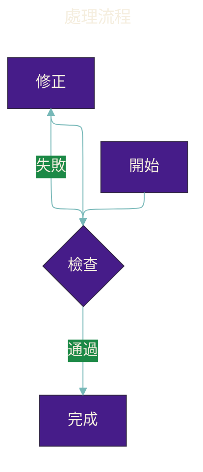

# alice-mmd

Obsidian 的獨立 Mermaid 文件插件。開啟 `.mmd` 文件即可查看圖表，點擊「Source」可編輯內容，變更後自動儲存，再次點擊模式按鈕返回預覽後渲染最新內容。外部程式修改文件時，由 Obsidian 的 TextFileView 重新載入內容。

## 安裝與建置

需要 Node.js 20 以上版本：

```sh
npm --prefix alice-mmd install
npm run build:mmd
```

將 `dist/alice-mmd/` 內的 `main.js`、`manifest.json`、`styles.css` 複製到筆記庫的 `.obsidian/plugins/alice-mmd/`，重新載入 Obsidian，在「設定 → 第三方外掛」啟用 **alice-mmd**。

Mermaid 與 ELK 會打包到插件，使用時不依賴 CDN 或網路。建置時需下載 npm 依賴。插件不依賴 alice-mindnight 或 alice-sidebar。

## 使用

在檔案總管右鍵點擊資料夾，選擇 **New mermaid**，即可在該資料夾建立文件；右鍵點擊檔案則建立於其所在資料夾。同名文件會自動加上編號，不會覆寫既有內容。

也可從命令面板執行 **alice-mmd: New mermaid**，或將既有 `.mmd` 文件放入筆記庫後開啟。每份文件包含一張圖，直接寫 Mermaid 語法，不加 Markdown 的三個反引號。



也可使用 `theme: dark`，或省略 `theme` 跟隨 Obsidian 深淺色模式。自訂 `themeVariables` 時建議使用 Mermaid 的 `base` 主題。更多範例見 [examples/elk.mmd](examples/elk.mmd)。

## 介面語言

按鈕、右鍵選單、命令、無障礙標籤與插件提示跟隨 Obsidian 的語言設定，支援繁體中文、簡體中文與英文；其他語言顯示英文。單一模式按鈕依目前模式顯示圖示搭配 `Preview`／`Source`，新建選單與命令固定使用 `New mermaid`。Mermaid 引擎本身的錯誤文字保留原文。

## 編輯與縮放

- 工具列使用單一模式切換按鈕：預覽時顯示 Mermaid 圖示與 `Preview`，編輯時顯示程式碼圖示與 `Source`，點擊即可切換。原始碼編輯區填滿工具列下方的整個文件面板，不限制置中寬度，不顯示邊框，沿用筆記字體、行高與留白。
- 雙擊圖表或預覽空白處進入原始碼編輯。編輯模式只顯示原始碼，隱藏圖表、mini map、縮放控制與渲染錯誤；再次點擊模式按鈕返回預覽後顯示最新圖表。
- 在圖表區滾動滑鼠滾輪或使用觸控板縮放手勢，以游標位置為中心縮放。
- 工具列 `−`／`+` 縮放圖表，百分比按鈕重設為 100%。縮放範圍為 5%–2000%。
- 在圖表預覽中按 `Cmd+0`（Windows／Linux 為 `Ctrl+0`）恢復 100% 縮放；也可從命令面板執行「恢復預設縮放」。
- 按住滑鼠左鍵拖拽圖表或空白處即可平移；也可使用預覽區捲軸。圖表連結與表單控制項保留原本點擊行為。
- 圖表超出預覽區時，右下角自動顯示 mini map，框線標示可見範圍；可點擊或拖拽縮圖定位。停止操作 1.5 秒後自動隱藏，再次縮放、平移或捲動時顯示；游標停留或拖拽縮圖時保持顯示。全部內容可見時隱藏。
- 編輯與重新渲染保留縮放倍率；縮放不修改 `.mmd` 或 Mermaid 配置。

## Outline

啟用 Obsidian 內建 Outline（大綱）核心插件，開啟 `.mmd` 後，渲染完成時會顯示圖中定義的對象與 ID。支援流程圖節點與子圖、時序圖參與者、ER 實體、類別圖類別、狀態圖狀態；其他圖表依 Mermaid 提供的節點資料顯示。

流程圖子圖會按父子關係排列，可沿用原生 Outline 的搜尋與摺疊操作。點擊對象可在預覽中定位；切到 Source 後可選取對應的原始碼 ID。修改後返回 Preview，重新解析並更新對象列表。

此整合擴充原生 Outline 檢視方法，不寫入 Markdown metadata；切回 `.md` 時沿用原生標題大綱，卸載插件會還原方法。Outline 整合與實際定位仍需在 Obsidian 中驗證。

## 配置支援範圍

插件不維護配置白名單；將 YAML `config` 的完整物件傳給所打包版本的 `mermaid.initialize()`，並保留原始 frontmatter，讓 Mermaid 處理 `title` 等資訊。包含 `layout`、`theme`、`themeVariables`、`themeCSS`、`look`、`fontFamily`、各圖表專屬選項，以及原生 frontmatter 通常不能覆寫的 `securityLevel`、`maxTextSize`、`maxEdges` 等初始化選項。

不同文件的初始化與渲染依序執行，每次重設配置，避免配置跨文件殘留。Mermaid 引擎獨立打包，不會更改 Obsidian 內建 Mermaid 的配置。

配置的名稱、有效值及圖表支援程度以實際安裝的 Mermaid 版本為準；未實作的選項不會因透傳而新增功能。ELK 已內建註冊，但僅能用於 Mermaid 支援 ELK 的圖表。需要外部字型或圖示包的配置仍需對應資源；此版本沒有額外註冊圖示包。YAML 只能表達資料，不能定義 JavaScript callback。

`startOnLoad` 可傳入配置，但插件自行管理渲染，不使用網頁自動掃描流程。`securityLevel` 預設沿用 Mermaid 的 `strict`；若在文件中改為 `loose`，即採用 Mermaid 對 HTML 與互動內容的較寬鬆處理，僅對可信文件使用。

本插件處理 `.mmd` 文件，不取代 Markdown 的 Mermaid 程式碼區塊，也不依賴 Mermaid Lens。

## 開發驗證

```sh
npm --prefix alice-mmd test
npm --prefix alice-mmd run build
```

自動測試涵蓋配置透傳、BOM／CRLF、錯誤處理、配置隔離、渲染序列與過期工作取消。這些測試使用引擎替身；實際 SVG、ELK、編輯儲存及多分頁行為仍需在 Obsidian 驗證。

參考：[Mermaid 配置](https://mermaid.js.org/config/configuration)、[Mermaid 配置結構](https://mermaid.js.org/config/schema-docs/config)、[Obsidian API](https://github.com/obsidianmd/obsidian-api)。
